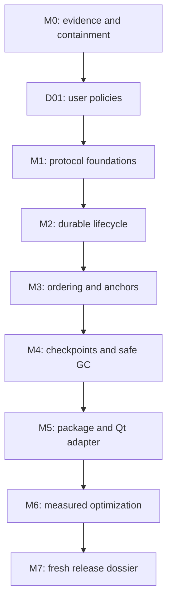

# collabtext reliability roadmap and implementation task list

**Created:** 2026-10-03  
**Baseline:** `046d375`  
**Execution branch:** `roadmap/reliability-v2`  
**Worktree:** `/home/clinton/dev/collabtext/.worktrees/reliability-v2`  
**Status:** M0 complete (V01–V08); D01, P01, and P02 complete. Continue with P03 from [TASKS.json](TASKS.json); the [kickoff handoff](../../handoff/2026-10-03-reliability-kickoff.md) describes the verified V01–V03 starting point; later task results are in [the task log](../../reports/vnext-task-log.md). All product-policy decisions are resolved; improve the existing C++ engine incrementally.

This roadmap implements the recommendations in the [evaluation](../../2026-10-03-library-evaluation.md) subject to the user's selected direction: improve the engine already implemented. It contains **62 active tasks in eight phases**, with dependencies, file scope, ordered steps, acceptance criteria, and verification. [TASKS.json](TASKS.json) is the machine-readable task/status registry. [EXECUTION.md](EXECUTION.md) tells an executor how to run one task without guessing. [DECISIONS.md](DECISIONS.md) records all resolved policies. [RUST_ASSESSMENT.md](RUST_ASSESSMENT.md) is informational background; its former adoption recommendation is withdrawn.

All breaking implementation work belongs in the worktree above. The user confirmed there is no production data, store, or history to preserve; the new API and formats can start fresh. A copy of these plans is kept in the original checkout's `docs/` for discovery; the worktree is the authoritative implementation copy. The user authorized implementation on this branch. A merge, publication, consumer-repository changes, or external messages require a separate instruction.

## Read first

1. Read [DECISIONS.md](DECISIONS.md): all Q1–Q4 are resolved. Retain and improve the native engine; do not reinstate migration work or replacement-backend options.
2. Read [EXECUTION.md](EXECUTION.md), [DECISIONS.md](DECISIONS.md), the binding [design constraints](../../specs/vnext-design-constraints.md), and the [API guide](../../specs/vnext-public-api.md) and [protocol contract](../../specs/vnext-protocol.md). V01–V08, D01, P01, and P02 are complete: the verification runner exists and the randomized suites are seeded, traced, and reducible (see "Randomized test contract" in EXECUTION.md). Later task artifacts remain planned until their creating tasks complete.
3. Select the next task whose dependencies are complete. Use the registry order as a safe serial execution order; do not treat phase numbering as permission to skip unfinished prerequisites.
4. Read the complete task in its phase file and its referenced specification before editing.
5. Update the registry and record evidence after completing the task. See the design gates for work that needs more expertise than routine implementation.

## Milestones and dependency order

| Milestone | Tasks | Deliverable / exit condition | Plan |
|---|---|---|---|
| M0: trustworthy baseline | V01–V08 | Complete: reproducible checks, visible regression cases, unsafe GC contained, replayable traces, corrected benchmarks and simulator, store fault injection, behavioural fixtures and API inventory | [01 — validation](01-validation.md) |
| M1: explicit protocol | D01, P01–P08 | User policies recorded; persistent actors; strict validation; sparse/versioned codecs; transactional transport contract | [02 — protocol](02-protocol.md) |
| M2: reliable lifecycle | L01–L08 | Actual editor survives local/remote replay, close/reopen, failed writes, sender/receiver restart, and segment arrival gaps | [03 — recovery](03-recovery.md) |
| M3: useful merge semantics | S01–S07 | Spec/model and production agree on contiguous concurrent passages, exact boundary affinity, undo, and supported deltas | [04 — semantics](04-semantics.md) |
| M4: safe reclamation | G01–G08 | Validated checkpoints, membership/retirement policy, durable per-stream coverage, and certificate-authorized memory/disk reclamation | [05 — reclamation](05-reclamation.md) |
| M5: reusable library | A01–A08 | Qt-free installable core, optional transport/Qt targets, complete document adapter, installed consumers, CI, and advisory device-retirement UI | [06 — public API](06-public-api.md) |
| M6: measured optimization | X01–X10 | Corrected trace baselines, independent optimizations, percentile/memory/recovery evidence, honest comparison report | [07 — performance](07-performance.md) |
| M7: fresh release | E03–E06 | Compilable new API examples, updated guarantees, acceptance/release dossier; E01/E02 removed | [08 — release](08-release.md) |

The diagram is a conservative serial route. Individual prerequisites in TASKS.json permit some tasks earlier: durable-file work can proceed alongside later codec work; sequence fixtures can be drafted before lifecycle completion; CMake target splitting can start after its own prerequisites. Parallel agents are not required. A single executor following registry order reaches every gate safely.

M0–M2 are the first implementation priority. M2 provides a recovery baseline with reclamation disabled, not a declaration that every release guarantee is complete. Shipping the final supported library requires M3–M7 as well. Unsafe GC must remain disabled until G06, even if tests or performance benchmarks previously depended on it.

## Scope and compatibility

The selected route evolves the existing C++20 Buffer and IdList engines, their SumTree/run storage and selective-undo machinery, one file-backed reference transport, and Qt integration. Repairs change only the components/invariants required by their acceptance tests. External algorithms can inform design and isolated comparison benchmarks can inform optimization; neither becomes a replacement engine. Rust rewrites, Yrs adoption, and backend feasibility trials are outside scope.

The implementation priorities are recovery and durability, explicit merge/anchor/undo/GC semantics, a supported public library and Qt adapter, then measured latency/memory improvements. Retain working code and fast paths where their invariants hold. A complete reference model supports local repairs; it is not a second production engine. The roadmap adds no rich text, new CRDT primitives, transport menagerie, SQLite prerequisite, or automatic peer eviction.

Breaking changes are expected in:

- actor/operation IDs: 16-bit actor and 32-bit counter assumptions become persistent actor identities and checked 64-bit counters;
- public operation/header exposure: opaque value types replace reliance on internal fields and source include paths;
- transport APIs: typed errors, delivery tokens, per-stream durable coverage, bounded polls, and explicit commit replace ambiguous callbacks and scalar GC claims;
- engine mutation/anchor APIs: explicit rejected/deferred outcomes, boundary affinity, wrong-epoch/unresolved anchors, and reset semantics;
- GC: a raw Global or scalar cannot authorize destructive reclamation;
- packaging: stable component targets replace unconditional Qt/QtTest linkage;
- wire/store formats: independently versioned envelopes, codecs, checkpoints, membership, and anchors.

[DECISIONS.md](DECISIONS.md) records the selected clean-start route. No old-store decoder, inspector, importer, history archive, source shim, or mixed-version protocol is required. New format versions still matter for future data and explicitly reject obsolete or unknown formats. Existing source/evaluation artifacts are regression evidence, not compatibility obligations.

An enrolled device may remain offline indefinitely; only explicit retirement removes its obligations. A configurable advisory reminder (proposed default 90 days), stale-device flag, and confirmation interface help review old devices without automatically retiring them. Undo AND redo persist across reopening within step/byte limits. These are accepted policies, not open questions.

## Design gates that a routine executor must not improvise

| Gate | Required artifact before implementation | Why it exists |
|---|---|---|
| D01 | Complete: [design constraints](../../specs/vnext-design-constraints.md) turn the settled policies into C1–C14, R1–R10, B1–B8, with an executable scope check | All user policies are settled; their written implementation contract is complete |
| P01 | Complete stable types, errors, ownership, counter, and version contracts | Partial API decisions create inconsistent consumers and codecs |
| S02 | Complete incremental ordering repair, transformation map, pseudocode, independent model, fixture/enumeration evidence | Ordering changes need precise invariants and verification within existing engines |
| G01 | Full membership/epoch/undo/anchor/checkpoint protocol and independent GC model | Durable observation alone does not permit reclamation |

Technical review at these gates does not mean repeatedly asking the user for routine implementation permission. It means a complete reviewable design with explicit invariants must exist before a less-capable executor proceeds. If a model cannot supply that artifact reliably, it records the gap and stops that dependent task rather than choosing an algorithm arbitrarily.

## Coverage of the evaluation

| Evaluation finding | Primary fixing tasks |
|---|---|
| F1: GC destroys insertion redo | V03, L06, G01–G03, G06–G08 |
| F2: compaction ignores remote undo obligations | V03, G01–G03, G06–G08 |
| F3: false common-observation meet | P03, G03 |
| F4: sender restart drops distinct operations | P02, L02, L04, L08 |
| F5: cursor/state recovery mismatch and own-log omission | P07, L03–L08, G04–G05 |
| F6: skipped missing/invalid older segments | L03, L08, G07 |
| F7: wrong anchor bias and lost retained positions | S04–S06, G01, G06, X07 |
| F8: character-interleaved concurrent passages | S01–S07 |
| F9: fake fsync and unsafe Save ordering | L01–L02, L07–L08 |
| F10: accepted invalid operations/Unicode/codecs | P04–P06, P08 |

Additional recommendations use the following traceability IDs in tasks:

| ID | Recommendation | Primary tasks |
|---|---|---|
| R1 | Persistent offline-safe identity, cloning/writer policy, counter exhaustion | P01–P02, L07 |
| R2 | Stable public types, source/API boundary, behavior/errors | P01, P06–P07, A02, A04–A06 |
| R3 | One complete document/session/Qt binding; obsolete wrappers removed; device-review UI | L05, L07, A03, A08 |
| R4 | Deterministic replay/reduction, realistic simulator, fault injection, sanitizer/model/CI evidence | V01–V05, V07, P08, L08, S06, G08, A07, E05 |
| R5 | Correct benchmarks, replay/merge metrics, percentiles, matched comparisons | V06, X01–X02, X09–X10 |
| R6 | Indexes, splice validation, run deletion/undo, IdList incremental paths, anchor/delta seeks | S07, X04–X08 |
| R7 | Summary/layout simplification, checked RAII allocation, actual memory/UndoMap reclamation | P03, G06–G08, X02–X06, X08 |
| R8 | Valid Unicode input; UTF-16 tree seeks; paint/cursor conversions | P04, A03, X07 |
| R9 | Callback ownership/reentrancy, applied/deferred distinction, batching/backpressure | P01, P05, P07, L04, A04, X09 |
| R10 | Undo step/byte limits, persistent retention/pins, snapshots, safe retirement and memory/disk reclamation | L06, G01–G08, A08, X02, X06, X09 |
| R11 | Honest guarantees/status, signing stub scope, architecture/docs | V08, D01, E04–E06 |
| R12 | Informational design/benchmark comparisons; replacement recommendation rejected by the user | S02, X10, E04; Q4 in DECISIONS.md |
| R13 | Package install/export, platform support, fresh versioned formats, installed examples | P01, P06–P07, A01–A07, E03–E06 |
| R14 | Explicit local_clear, recovery, and collaborative reset semantics | V08, A05, E03 |

No recommendation is considered complete merely because it appears in a plan. E05 records implementation commits and exact passing acceptance tests or explicit user-approved deferrals. Tasks initially start `not_started`; TASKS.json records current completion and evidence.

## Implementation handoff

- **Next in serial order:** P03. P04, L01, and S01 are also structurally ready.
- **Identity is durable or it is an error:** [ActorId.h](../../../libs/collabtext/include/collabtext/ActorId.h)
  and `ReplicaState` reserve an operation id before handing it out, refuse to
  replace corrupt private state, and take writer leases exclusively. No engine
  consumes `ActorId` yet — that adoption is deliberately staged.
- **The API is written down:** [vnext-public-api.md](../../specs/vnext-public-api.md)
  fixes `Result<T>`, `ActorId`, opaque operations, `ApplyOutcome`, and the
  callback contract; [vnext-protocol.md](../../specs/vnext-protocol.md) fixes the
  wire formats, decode stages, contiguous coverage frontier, and lifecycle
  sequences. Changes to either are changes to the plan.
- **The contract is binding:** [vnext-design-constraints.md](../../specs/vnext-design-constraints.md)
  turns the four resolved policies into citable constraints (C1–C14), the release
  invariants (R1–R10), and the intended behavior (B1–B8).
  `check-scope.py --strict` proves no task asks for a Rust rewrite, Yrs adoption, a
  backend experiment, or legacy-data migration; run it when the registry changes. M0 is complete: verification entry points, evaluation
  regressions, reclamation containment, replayable traces, a correct network
  model, honest benchmarks, store fault injection, and a written API inventory
  with frozen behavioural fixtures.
- **Store faults are injectable:** `tests/StoreFaultHarness.h` hooks every step of the durable write sequence, and `store_crash_worker` dies mid-write on purpose. It is not durability evidence — production still calls no `fsync` (F9), and process death is not power loss.
- **Benchmarks report honestly or not at all:** every figure carries its unit and work count, an unmeasured metric is absent rather than zero, convergence is asserted, and RSS is never presented as engine memory. Two long-running suites (`tst_benchmark`, `tst_realistic`) are excluded from the fast selection and both hid stale expectations — run them when touching their subject area.
- **NetworkSim is now honest about partitions:** `disconnect` blocks both directions and queues a disconnected replica's work, `allow_reorder` implements per-producer monotonicity, and asymmetric loss has its own `block_link` API. A scenario can no longer pass by not noticing a partition.
- **All product choices settled:** D01 writes their implementation contract after V08; it does not require another backend question or user confirmation.
- **Algorithm/protocol blocked until designed:** S03 depends on S02; G02 depends on G01; physical GC depends on all G06 prerequisites.
- **Completed kickoff:** reproducible build/test modes, F1–F8 regressions, and conservative GC containment are committed. The worktree contains C++/CMake changes; master remains at the evaluated revision.
- **Integration:** complete installed examples and release evidence before proposing a merge to master. No production porting deadline or legacy-data migration is needed.

## Plan revision record

On 2026-10-03 the user clarified preproduction status and authorized a complete fresh start. E01/E02 were removed, migration/shim requirements were removed from retained tasks, persistent undo/redo became the only route, and A08 added advisory device review with explicit retirement. Active count changed from 63 to 62. The original evaluation remains a historical assessment of revision 046d375; data-preservation assumptions in that report do not override this decision.

Later on 2026-10-03 the user clarified that the goal is improving the already implemented C++ engine, not rewriting it or adopting Yrs. Q4 is resolved accordingly. D01/S02/S03/X10 now enforce incremental native repair; the Rust assessment's adoption recommendation and trial are removed. External comparisons remain informational. The task count stays 62.

Implementation then began on the isolated branch: V01 (`9d5541b`), V02 (`cebabc3`), V03 (`3f4a210`), and V04 (`e5eb6f5`, `97a306c`), and V05 (`5f9f759`), V06 (`74732ca`), and V07 (`5a18f8c`), and V08 (`37b26db`) completed. V04 made the randomized suites seeded, traced, and reducible; the seed and trace-artifact contract is documented in EXECUTION.md. V05 corrected the simulated network's partition and ordering model and fixed a `drain()` clock bug. V06 repaired benchmark timing, units, correctness assertions, and memory labels. V07 added store fault injection and subprocess crash harnesses. V08 wrote
[api-inventory.md](api-inventory.md) and froze behavioural fixtures, including
the red test for F8. TASKS.json records verification and evidence.

Two failures that predate their discovery hid in the excluded suites: `tst_realistic`'s `networksim_compact_all` and `tst_benchmark`'s `gc_effectiveness` both asserted that reclamation removes tombstones, which has been false since V03's containment change. Both now assert retention. Treat the fast-suite exclusion list as a place where failures hide, and run the excluded suites when touching their subject area.
