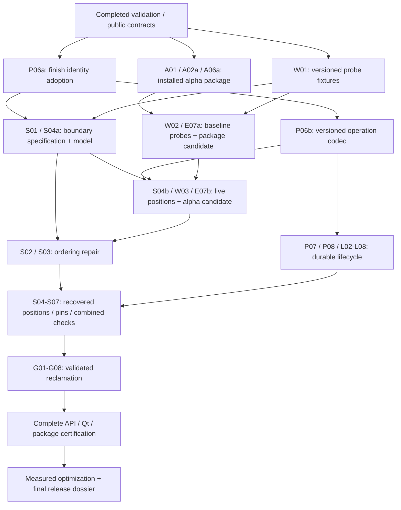

# collabtext reliability roadmap and implementation task list

**Created:** 2026-10-03  
**Baseline:** `046d375`  
**Execution branch:** `roadmap/reliability-v2`  
**Worktree:** `/home/clinton/dev/collabtext/.worktrees/reliability-v2`  
**Status:** V01–V08, D01, P01–P05, and L01 complete. P06a is in progress: both design gates now exist and run (identity ordering, and identity allocation), so what remains is the engine migration itself — steps 3–6. A01, W01, and S01 are independently ready; the early consumer route follows the running P06a task. Read the [2026-10-04 progress review](../../reports/2026-10-04-reliability-progress-review.md), [current handoff](../../handoff/2026-10-04-reliability-review.md), and [task registry](TASKS.json). W1–W6 and Wave ask2 are accepted into dependency-gated tasks; the [early consumer lane](00-consumer-integration.md) brings packaging, live positions, probes and alpha preparation forward without claiming implementation.

This roadmap implements the recommendations in the [evaluation](../../2026-10-03-library-evaluation.md) subject to the user's selected direction: improve the engine already implemented. It contains **72 active tasks across eight technical areas plus an early consumer integration lane**, with dependencies, file scope, ordered steps, acceptance criteria, and verification. [TASKS.json](TASKS.json) is the machine-readable task/status registry. [EXECUTION.md](EXECUTION.md) tells an executor how to run one task without guessing. [DECISIONS.md](DECISIONS.md) records all resolved policies. [RUST_ASSESSMENT.md](RUST_ASSESSMENT.md) is informational background; its former adoption recommendation is withdrawn.

All breaking implementation work belongs in the worktree above. The user confirmed there is no production data, store, or history to preserve; the new API and formats can start fresh. The original checkout's `docs/` contains older discovery copies; this amendment lives in the authoritative worktree. The user authorized implementation on this branch. A merge, publication, consumer-repository changes, or external messages require a separate instruction.

## Read first

1. Read [DECISIONS.md](DECISIONS.md): all Q1–Q4 are resolved. Retain and improve the native engine; do not reinstate migration work or replacement-backend options.
2. Read [EXECUTION.md](EXECUTION.md), [DECISIONS.md](DECISIONS.md), the binding [design constraints](../../specs/vnext-design-constraints.md), and the [API guide](../../specs/vnext-public-api.md) and [protocol contract](../../specs/vnext-protocol.md). V01–V08, D01, P01–P05, and L01 are complete: the verification runner exists and the randomized suites are seeded, traced, and reducible (see "Randomized test contract" in EXECUTION.md). Later task artifacts remain planned until their creating tasks complete.
3. Select the next task whose dependencies are complete. Use the registry order as a safe serial execution order; do not treat phase numbering as permission to skip unfinished prerequisites.
4. Read the complete task in its phase file and its referenced specification before editing.
5. Update the registry and record evidence after completing the task. See the design gates for work that needs more expertise than routine implementation.

## Milestones and dependency order

Read [00 — early consumer integration](00-consumer-integration.md) for the preferred serial schedule, probe matrix, exact gates and publication procedure. Milestone labels group final deliverables; they are not an instruction to finish recovery before packaging or live anchors.

| Milestone | Tasks | Deliverable / exit condition | Plan |
|---|---|---|---|
| Early consumer package | A01, A02a, A06a, W01–W02, E07a | Implemented installed API, relocated external consumer, eight-probe baseline, prepared package alpha | [00 — consumer lane](00-consumer-integration.md) |
| Early live positions | S01, S04a–S04b, W03, E07b (after P06a/P06b) | Independent boundary gate, scoped typed live positions/token codec, installed strict probes, prepared position alpha; no L08/S03 prerequisite | [04 — semantics](04-semantics.md) |
| M0: trustworthy baseline | V01–V08 | Complete: reproducible checks, visible regression cases, unsafe GC contained, replayable traces, corrected benchmarks and simulator, store fault injection, behavioural fixtures and API inventory | [01 — validation](01-validation.md) |
| M1: explicit protocol | D01, P01–P08, including P06a/P06b (P01–P05 done) | User policies recorded; persistent actors; strict validation; sparse/versioned codecs; transactional transport contract | [02 — protocol](02-protocol.md) |
| M2: reliable lifecycle | L01–L08 (L01 primitives done) | Actual editor survives local/remote replay, close/reopen, failed writes, sender/receiver restart, and segment arrival gaps | [03 — recovery](03-recovery.md) |
| M3: useful merge semantics | S01–S07 | Spec/model and production agree on contiguous concurrent passages, exact boundary affinity, undo, and supported deltas | [04 — semantics](04-semantics.md) |
| M4: safe reclamation | G01–G08 | Validated checkpoints, membership/retirement policy, durable per-stream coverage, and certificate-authorized memory/disk reclamation | [05 — reclamation](05-reclamation.md) |
| M5: reusable library | A01–A08 | Qt-free installable core, optional transport/Qt targets, complete document adapter, installed consumers, CI, and advisory device-retirement UI | [06 — public API](06-public-api.md) |
| M6: measured optimization | X01–X10 | Corrected trace baselines, independent optimizations, percentile/memory/recovery evidence, honest comparison report | [07 — performance](07-performance.md) |
| M7: fresh release | E03–E06 | Compilable new API examples, updated guarantees, acceptance/release dossier; E01/E02 removed | [08 — release](08-release.md) |

The diagram groups work and omits some edges; TASKS.json is authoritative. The
preferred single-executor order is: finish current P06a; A01 → A02a → A06a;
W01 → W02 → E07a; S01 → S04a; P06b → S04b → W03 → E07b; S02 → S03;
P07 → P08 → L02–L08; then S04–S07 and the remaining G/A/X/E tasks in registry
order. A blocked current task does not prevent independent ready work.

Baseline/alpha preparation does not complete recovery, persistent undo/redo,
durable pins, or repaired ordering. Live positions are usable before those gates
with explicit limits. Unsafe physical GC remains disabled until G06. External
publication/merging still requires a separate user instruction; prepared alphas
are concrete reviewable candidates, not already published availability.

## Scope and compatibility

The selected route evolves the existing C++20 Buffer and IdList engines, their SumTree/run storage and selective-undo machinery, one file-backed reference transport, and Qt integration. Repairs change only the components/invariants required by their acceptance tests. External algorithms can inform design and isolated comparison benchmarks can inform optimization; neither becomes a replacement engine. Rust rewrites, Yrs adoption, and backend feasibility trials are outside scope.

The immediate route completes identity adoption, early packaging/probes and live anchors, then ordering and the full durable lifecycle; persistent undo/redo, pins/GC and final API/Qt certification remain required before the supported release. Measured latency/memory work follows correctness. Retain working code and fast paths where their invariants hold. A complete reference model supports local repairs; it is not a second production engine. The roadmap adds no rich text, new CRDT primitives, transport menagerie, SQLite prerequisite, or automatic peer eviction.

Breaking changes are expected in:

- actor/operation IDs: 16-bit actor and 32-bit counter assumptions become persistent actor identities and checked 64-bit counters;
- public operation/header exposure: opaque value types replace reliance on internal fields and source include paths;
- transport APIs: typed errors, delivery tokens, per-stream durable coverage, bounded polls, and explicit commit replace ambiguous callbacks and scalar GC claims;
- engine mutation/anchor APIs: explicit rejected/deferred outcomes, boundary affinity, wrong-epoch/unresolved anchors, and reset semantics;
- GC: a raw Global or scalar cannot authorize destructive reclamation;
- packaging: stable component targets replace unconditional Qt/QtTest linkage;
- wire/store formats: independently versioned envelopes, codecs, checkpoints, membership, and anchors.

[DECISIONS.md](DECISIONS.md) records the selected clean-start route. No old-store decoder, inspector, importer, history archive, source shim, or mixed-version protocol is required. New format versions still matter for future data and explicitly reject obsolete or unknown formats. Existing source/evaluation artifacts are regression evidence, not compatibility obligations.

An enrolled device may remain offline indefinitely; only explicit retirement removes its obligations. A configurable advisory reminder (proposed default 90 days), stale-device flag, and confirmation interface help review old devices without automatically retiring them. Undo AND redo persist across reopening within step/byte limits. These are accepted policies, not open questions.

## Design gates that a routine executor must not improvise

| Gate | Required artifact before implementation | Why it exists |
|---|---|---|
| D01 | Complete: [design constraints](../../specs/vnext-design-constraints.md) turn the settled policies into C1–C14, R1–R10, B1–B8, with an executable scope check | All user policies are settled; their written implementation contract is complete |
| P01 | Complete stable types, errors, ownership, counter, and version contracts | Partial API decisions create inconsistent consumers and codecs |
| S04a | Complete scoped boundary contract, transformation map, codec rules and independent position model | Live anchors need stable causal identities and explicit deletion/affinity outcomes without waiting for full ordering/recovery |
| S02 | Complete incremental ordering repair, transformation map, pseudocode, independent model, fixture/enumeration evidence | Ordering changes need precise invariants and verification within existing engines |
| G01 | Full membership/epoch/undo/anchor/checkpoint protocol and independent GC model | Durable observation alone does not permit reclamation |

Technical review at these gates does not mean repeatedly asking the user for routine implementation permission. It means a complete reviewable design with explicit invariants must exist before a less-capable executor proceeds. If a model cannot supply that artifact reliably, it records the gap and stops that dependent task rather than choosing an algorithm arbitrarily.

## Coverage of the evaluation

| Evaluation finding | Primary fixing tasks |
|---|---|
| F1: GC destroys insertion redo | V03, L06, G01–G03, G06–G08 |
| F2: compaction ignores remote undo obligations | V03, G01–G03, G06–G08 |
| F3: false common-observation meet | P03, G03 |
| F4: sender restart drops distinct operations | P02, L02, L04, L08 |
| F5: cursor/state recovery mismatch and own-log omission | P07, L03–L08, G04–G05 |
| F6: skipped missing/invalid older segments | L03, L08, G07 |
| F7: wrong anchor bias and lost retained positions | S04a–S04b, W03, S04–S06, G01, G06, X07 |
| F8: character-interleaved concurrent passages | S01–S07 |
| F9: fake fsync and unsafe Save ordering | L01–L02, L07–L08 |
| F10: accepted invalid operations/Unicode/codecs | P04–P06, P08 |

Additional recommendations use the following traceability IDs in tasks:

| ID | Recommendation | Primary tasks |
|---|---|---|
| R1 | Persistent offline-safe identity, cloning/writer policy, counter exhaustion | P01–P02, L07 |
| R2 | Stable public types, source/API boundary, behavior/errors | P01, P06–P07, A02, A04–A06 |
| R3 | One complete document/session/Qt binding; obsolete wrappers removed; device-review UI | L05, L07, A03, A08 |
| R4 | Deterministic replay/reduction, realistic simulator, fault injection, sanitizer/model/CI evidence | V01–V05, V07, P08, L08, S06, G08, A07, E05 |
| R5 | Correct benchmarks, replay/merge metrics, percentiles, matched comparisons | V06, X01–X02, X09–X10 |
| R6 | Indexes, splice validation, run deletion/undo, IdList incremental paths, anchor/delta seeks | S07, X04–X08 |
| R7 | Summary/layout simplification, checked RAII allocation, actual memory/UndoMap reclamation | P03, G06–G08, X02–X06, X08 |
| R8 | Valid Unicode input; UTF-16 tree seeks; paint/cursor conversions | P04, A03, X07 |
| R9 | Callback ownership/reentrancy, applied/deferred distinction, batching/backpressure | P01, P05, P07, L04, A04, X09 |
| R10 | Undo step/byte limits, persistent retention/pins, snapshots, safe retirement and memory/disk reclamation | L06, G01–G08, A08, X02, X06, X09 |
| R11 | Honest guarantees/status, signing stub scope, architecture/docs | V08, D01, E04–E06 |
| R12 | Informational design/benchmark comparisons; replacement recommendation rejected by the user | S02, X10, E04; Q4 in DECISIONS.md |
| R13 | Package install/export, platform support, fresh versioned formats, installed examples | P01, P06–P07, A01–A07, E03–E06 |
| R14 | Explicit local_clear, recovery, and collaborative reset semantics | V08, A05, E03 |

No recommendation is considered complete merely because it appears in a plan. E05 records implementation commits and exact passing acceptance tests or explicit user-approved deferrals. Tasks initially start `not_started`; TASKS.json records current completion and evidence.

## Implementation handoff

- **Next:** P06a steps 3–6 — widen the engine's identity types to the 24-byte identity, allocate per the run-interval contract in vnext-identity.md §3.2 rather than one tick per scalar, then measure the real layout. Both design gates are landed; the migration itself is not. Then follow the early consumer sequence in 00-consumer-integration.md rather than the old full-recovery-first route. A01/W01/S01 can proceed independently; P06b still follows its own identity prerequisite; S04a, S02 and G01 require complete specifications and independent models before their dependent algorithms.
- **Independent review:** the [review report](../../reports/2026-10-04-reliability-progress-review.md) records reproduced defects and fixes in P02/P04/P05/L01, executable evidence, and limitations. The old kickoff handoff is historical.
- **Identity:** ReplicaState now has one move-only kernel-lease owner per private directory, nonzero counter reservations, strict state directives, and checked atomic persistence. The allocation contract is written and executable (vnext-identity.md §3.1–§3.8, with an independent model and a checked `reserve_run`), including the gap-record obligation a crash between reservation and log append creates. ActorId is still not consumed by the legacy engine; P06a steps 3–6 must finish that adoption.
- **Validation:** the bounded reader rejects literal/escaped string overflow and duplicate keys; semantic validation also checks actor head-of-line queues. Deferred and diagnostic quarantine queues are separately bounded. The caller/store retains rejected input. Legacy operation serializers remain until P06b; P04/P05 did not complete all of F10.
- **Coverage:** Global::coverage_intersection is a durable-watermark intersection; Global::meet is a nonzero-min summary fold. The latter cannot authorize GC. F3's marker was removed for the intended API; an old probe calling meet is not the new coverage contract.
- **Durability:** L01 provides checked file primitives, first-append directory barriers, unique temporary files, kernel leases, and explicit uncertain publication outcomes. SegmentWriter/StreamSync/session/save wiring remains L02–L08; F9 is not yet solved end to end. Process-kill evidence is not power-loss/platform certification.
- **Known gates:** F4–F8 remain explicit expected failures. Affinity/end/context/token retention, contiguous concurrent passages, persisted undo/redo, safe checkpoints/GC, headless package exports, and final callback batching/reentry all remain required work. Physical reclamation stays disabled until G06.
- **External consumers:** [W1–W6](../../specs/vnext-external-position-contract.md) require stable library-owned token bytes, typed positions, durable external pins and recovery frontiers, historical projection rules, and installed-only tests. Formatting remains consumer-owned. [Reply to Wave](../../handoff/2026-10-04-reply-to-wave.md) is a draft for the user to relay; no external message or consumer edit was made.
- **Verification:** run the runner and both plan checks from EXECUTION.md. Full final review evidence includes the expensive Release benchmark/realistic suites; fast tests exclude only those two. Read the actual named cases and known limits, not only CTest totals.
- **Integration:** all breaking implementation stays on this worktree. Master remains the evaluated source revision; merge/publication is a separate user instruction. Copies in master docs are for discovery; execute against this branch's registry.

## Plan revision record

On 2026-10-03 the user clarified preproduction status and authorized a complete fresh start. E01/E02 were removed, migration/shim requirements were removed from retained tasks, persistent undo/redo became the only route, and A08 added advisory device review with explicit retirement. Active count changed from 63 to 62. The original evaluation remains a historical assessment of revision 046d375; data-preservation assumptions in that report do not override this decision.

Later on 2026-10-03 the user clarified that the goal is improving the already implemented C++ engine, not rewriting it or adopting Yrs. Q4 is resolved accordingly. D01/S02/S03/X10 now enforce incremental native repair; the Rust assessment's adoption recommendation and trial are removed. External comparisons remain informational. The task count stays 62.

Implementation then began on the isolated branch: V01 (`9d5541b`), V02 (`cebabc3`), V03 (`3f4a210`), and V04 (`e5eb6f5`, `97a306c`), and V05 (`5f9f759`), V06 (`74732ca`), and V07 (`5a18f8c`), and V08 (`37b26db`) completed. V04 made the randomized suites seeded, traced, and reducible; the seed and trace-artifact contract is documented in EXECUTION.md. V05 corrected the simulated network's partition and ordering model and fixed a `drain()` clock bug. V06 repaired benchmark timing, units, correctness assertions, and memory labels. V07 added store fault injection and subprocess crash harnesses. V08 wrote
[api-inventory.md](api-inventory.md) and froze behavioural fixtures, including
the red test for F8. TASKS.json records verification and evidence.

Two failures that predate their discovery hid in the excluded suites: `tst_realistic`'s `networksim_compact_all` and `tst_benchmark`'s `gc_effectiveness` both asserted that reclamation removes tombstones, which has been false since V03's containment change. Both now assert retention. Treat the fast-suite exclusion list as a place where failures hide, and run the excluded suites when touching their subject area.

On 2026-10-04 P06 was split into P06a (engine identity adoption) and P06b (opaque
codecs); the active count is 63. P05 and L01 subsequently landed. Independent
review corrected ownership, validation limits, overflow retention, and durable
filesystem behavior. On 2026-10-05 P06a's second design gate landed: the
allocation-domain contract (vnext-identity.md §3.1–§3.8), an independent model, 16
fixtures, and the checked `CheckedCounter::reserve_run` they compare against. The
decision it records is that one local operation reserves a *run interval* — its
items and then its own identity — instead of one counter per character, which
reproduces the legacy ordering value for value; a packed subidentity was
considered and rejected because it changes equal-locator order. P06a steps 3–6,
the engine migration, remain. Wave's requests were integrated as W1–W6 into 13 existing
tasks, with no dependency bypass or completed-status promotion. The supported
published vNext token contract is a future persisted-data obligation; the user's
permission to discard pre-vNext experimental stores remains unchanged.

On 2026-10-04 the user authorized implementing Wave ask2 sequencing in this
worktree roadmap. Nine tasks were added (W01–W03, A02a, A06a, S04a–S04b,
E07a–E07b), bringing the count to 72. A01 no longer waits for P06b/L08;
packaging/header/export tasks no longer wait for the complete API. Live boundary
work has a narrow independent-model gate and no S03/L08 dependency. S02 design
also no longer waits for recovery. S04 retains final order/recovery certification,
S05 retains durable pin/history prerequisites, and GC remains contained. The
registry's transitive sequencing guards prevent those broad gates reappearing.
Existing statuses/implementation evidence were preserved. All alpha publication,
external consumer edits/messages and master integration remain separate actions.
