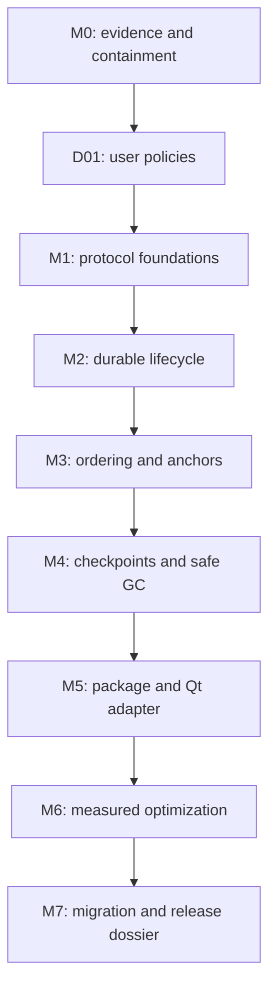

# collabtext reliability roadmap and implementation task list

**Created:** 2026-10-03  
**Baseline:** `046d375`  
**Execution branch:** `roadmap/reliability-v2`  
**Worktree:** `/home/clinton/dev/collabtext/.worktrees/reliability-v2`  
**Status:** planning complete; four policy answers pending; implementation not started.

This roadmap implements the recommendations in the [evaluation](../../2026-10-03-library-evaluation.md). It contains **63 tasks in eight phases**, with dependencies, file scope, ordered steps, acceptance criteria, and verification. [TASKS.json](TASKS.json) is the machine-readable task/status registry. [EXECUTION.md](EXECUTION.md) tells an executor how to run one task without guessing. [DECISIONS.md](DECISIONS.md) records policy choices and blocks dependent work until the user answers.

All breaking implementation work belongs in the worktree above. `master` remains available to existing consumers. A copy of these plans is kept in the original checkout's `docs/` for discovery; the worktree is the authoritative implementation copy. This planning deliverable does not authorize a merge, publication, consumer-repository changes, or external messages.

## Read first

1. Read [DECISIONS.md](DECISIONS.md), especially pending Q1–Q4 and the distinction between migration, source compatibility, and live mixed-version editing.
2. Read [EXECUTION.md](EXECUTION.md). Start with V01; do not assume its verification script or other planned files already exist.
3. Select the next task whose dependencies are complete. Use the registry order as a safe serial execution order; do not treat phase numbering as permission to skip unfinished prerequisites.
4. Read the complete task in its phase file and its referenced specification before editing.
5. Update the registry and record evidence after completing the task. See the design gates for work that needs more expertise than routine implementation.

## Milestones and dependency order

| Milestone | Tasks | Deliverable / exit condition | Plan |
|---|---|---|---|
| M0: trustworthy baseline | V01–V08 | Reproducible checks, visible regression cases, unsafe GC contained, replayable traces, corrected benchmark/simulator, frozen legacy fixtures | [01 — validation](01-validation.md) |
| M1: explicit protocol | D01, P01–P08 | User policies recorded; persistent actors; strict validation; sparse/versioned codecs; transactional transport contract | [02 — protocol](02-protocol.md) |
| M2: reliable lifecycle | L01–L08 | Actual editor survives local/remote replay, close/reopen, failed writes, sender/receiver restart, and segment arrival gaps | [03 — recovery](03-recovery.md) |
| M3: useful merge semantics | S01–S07 | Spec/model and production agree on contiguous concurrent passages, exact boundary affinity, undo, and supported deltas | [04 — semantics](04-semantics.md) |
| M4: safe reclamation | G01–G08 | Validated checkpoints, membership/retirement policy, durable per-stream coverage, and certificate-authorized memory/disk reclamation | [05 — reclamation](05-reclamation.md) |
| M5: reusable library | A01–A07 | Qt-free installable core, optional transport/Qt targets, complete document adapter, external consumers and CI | [06 — public API](06-public-api.md) |
| M6: measured optimization | X01–X10 | Corrected trace baselines, independent optimizations, percentile/memory/recovery evidence, honest comparison report | [07 — performance](07-performance.md) |
| M7: consumer transition | E01–E06 | Read-only legacy inspector, migration tool, compilable porting examples, updated guarantees, acceptance/release dossier | [08 — release](08-release.md) |

The diagram is a conservative serial route. Individual prerequisites in TASKS.json permit some tasks earlier: durable-file work can proceed alongside later codec work; sequence fixtures can be drafted before lifecycle completion; CMake target splitting can start after its own prerequisites. Parallel agents are not required. A single executor following registry order reaches every gate safely.

M0–M2 are the first implementation priority. M2 provides a recovery baseline with reclamation disabled, not a declaration that every release guarantee is complete. Shipping the final supported library requires M3–M7 as well. Unsafe GC must remain disabled until G06, even if tests or performance benchmarks previously depended on it.

## Scope and compatibility

The provisional route retains C++20 Buffer and IdList engines, one file-backed reference transport, and optional Qt integration. It does not add rich text, maps/counters, a transport menagerie, SQLite as a prerequisite, automatic peer eviction, or a replacement CRDT backend. Backend comparison is a measured contingency, not a rewrite mandate.

Breaking changes are expected in:

- actor/operation IDs: 16-bit actor and 32-bit counter assumptions become persistent actor identities and checked 64-bit counters;
- public operation/header exposure: opaque value types replace reliance on internal fields and source include paths;
- transport APIs: typed errors, delivery tokens, per-stream durable coverage, bounded polls, and explicit commit replace ambiguous callbacks and scalar GC claims;
- engine mutation/anchor APIs: explicit rejected/deferred outcomes, boundary affinity, wrong-epoch/unresolved anchors, and reset semantics;
- GC: a raw Global or scalar cannot authorize destructive reclamation;
- packaging: stable component targets replace unconditional Qt/QtTest linkage;
- wire/store formats: independently versioned envelopes, codecs, checkpoints, membership, and anchors.

[DECISIONS.md](DECISIONS.md) details the recommended migration-only compatibility route. Compile-time compatibility wrappers are allowed only when they cannot fabricate success or GC safety. A consumer that compiles unchanged may still be incompatible on disk or at the protocol boundary; the migration guide must spell that out.

Keep old stores untouched. Migration should create a new store from correctly reconstructed legacy content, archive old history, translate durable anchors where possible, and report ambiguity. The old implementation may have reused operation IDs or never durably written some edits; an importer must not promise to recover information that is absent. The safe initial migration starts a new active undo history while preserving old provenance; undo persistence applies to subsequent vNext sessions.

## Design gates that a routine executor must not improvise

| Gate | Required artifact before implementation | Why it exists |
|---|---|---|
| D01 | Recorded Q1–Q4 answers and compatibility contract | Product policy is not an implementation guess |
| P01 | Complete stable types, errors, ownership, counter, and version contracts | Partial API decisions create inconsistent consumers and codecs |
| S02 | Full ordering algorithm specification, pseudocode, independent executable model, fixture/enumeration evidence | A comparator tweak is not a valid new sequence CRDT |
| G01 | Full membership/epoch/undo/anchor/checkpoint protocol and independent GC model | Durable observation alone does not permit reclamation |
| E02 | Selected migration route and explicit legacy-history exception | New semantics cannot safely reinterpret old stores in place |

Technical review at these gates does not mean repeatedly asking the user for routine implementation permission. It means a complete reviewable design with explicit invariants must exist before a less-capable executor proceeds. If a model cannot supply that artifact reliably, it records the gap and stops that dependent task rather than choosing an algorithm arbitrarily.

## Coverage of the evaluation

| Evaluation finding | Primary fixing tasks |
|---|---|
| F1: GC destroys insertion redo | V03, L06, G01–G03, G06–G08 |
| F2: compaction ignores remote undo obligations | V03, G01–G03, G06–G08 |
| F3: false common-observation meet | P03, G03 |
| F4: sender restart drops distinct operations | P02, L02, L04, L08, E01 |
| F5: cursor/state recovery mismatch and own-log omission | P07, L03–L08, G04–G05 |
| F6: skipped missing/invalid older segments | L03, L08, G07 |
| F7: wrong anchor bias and lost retained positions | S04–S06, G01, G06, E02, X07 |
| F8: character-interleaved concurrent passages | S01–S07 |
| F9: fake fsync and unsafe Save ordering | L01–L02, L07–L08 |
| F10: accepted invalid operations/Unicode/codecs | P04–P06, P08 |

Additional recommendations use the following traceability IDs in tasks:

| ID | Recommendation | Primary tasks |
|---|---|---|
| R1 | Persistent offline-safe identity, cloning/writer policy, counter exhaustion | P01–P02, L07 |
| R2 | Stable public types, source/API boundary, behavior/errors | P01, P06–P07, A02, A04–A06 |
| R3 | One complete document/session/Qt binding; obsolete wrappers removed | L05, L07, A03 |
| R4 | Deterministic replay/reduction, realistic simulator, fault injection, sanitizer/model/CI evidence | V01–V05, V07, P08, L08, S06, G08, A07, E05 |
| R5 | Correct benchmarks, replay/merge metrics, percentiles, matched comparisons | V06, X01–X02, X09–X10 |
| R6 | Indexes, splice validation, run deletion/undo, IdList incremental paths, anchor/delta seeks | S07, X04–X08 |
| R7 | Summary/layout simplification, checked RAII allocation, actual memory/UndoMap reclamation | P03, G06–G08, X02–X06, X08 |
| R8 | Valid Unicode input; UTF-16 tree seeks; paint/cursor conversions | P04, A03, X07 |
| R9 | Callback ownership/reentrancy, applied/deferred distinction, batching/backpressure | P01, P05, P07, L04, A04, X09 |
| R10 | Undo step/byte limits, persistent retention/pins, snapshots, bounded memory/disk | L06, G01–G08, X02, X06, X09 |
| R11 | Honest guarantees/status, signing stub scope, architecture/docs | V08, D01, E04–E06 |
| R12 | Conditional backend study with matched data, retain native direction unless chosen otherwise | S02, X10, E04 |
| R13 | Package install/export, platform support, schema/store/consumer migration | P01, P06–P07, A01–A07, E01–E06 |
| R14 | Explicit local_clear, recovery, and collaborative reset semantics | V08, A05, E03 |

No recommendation is considered complete merely because it appears in a plan. E05 records implementation commits and exact passing acceptance tests or explicit user-approved deferrals. All tasks start `not_started`.

## Implementation handoff

- **Immediately available:** V01, followed by independent baseline/fixture/containment tasks as dependencies finish.
- **Policy blocked:** D01 and tasks that depend on it; planning defaults are not approved answers.
- **Algorithm/protocol blocked until designed:** S03 depends on S02; G02 depends on G01; physical GC depends on all G06 prerequisites.
- **No changes made yet:** production C++, CMake, serialized formats, and external consumers remain as at the evaluated revision.
- **Integration:** complete consumer ports and release evidence before proposing a merge to master; do not announce a consumer porting deadline without an explicit user decision.
